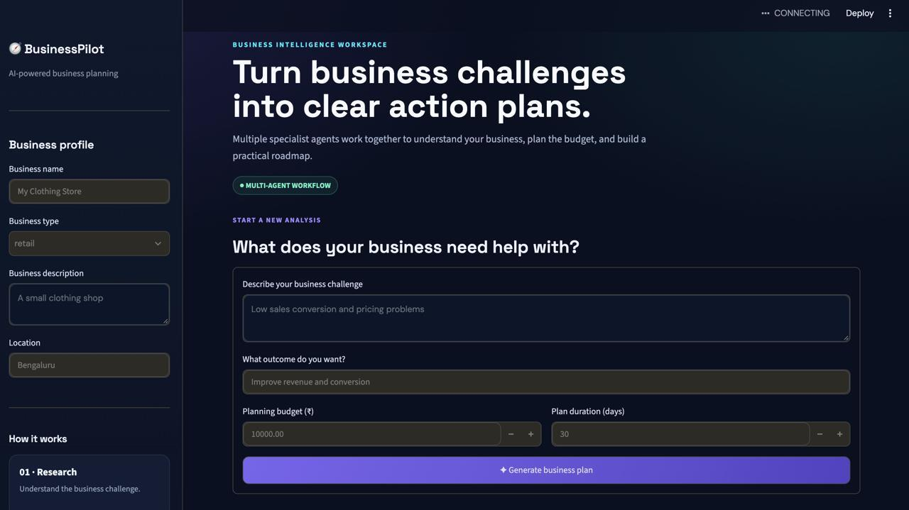
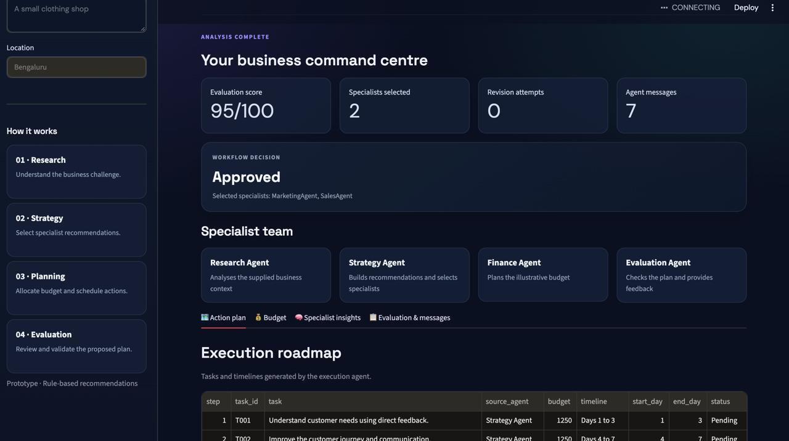
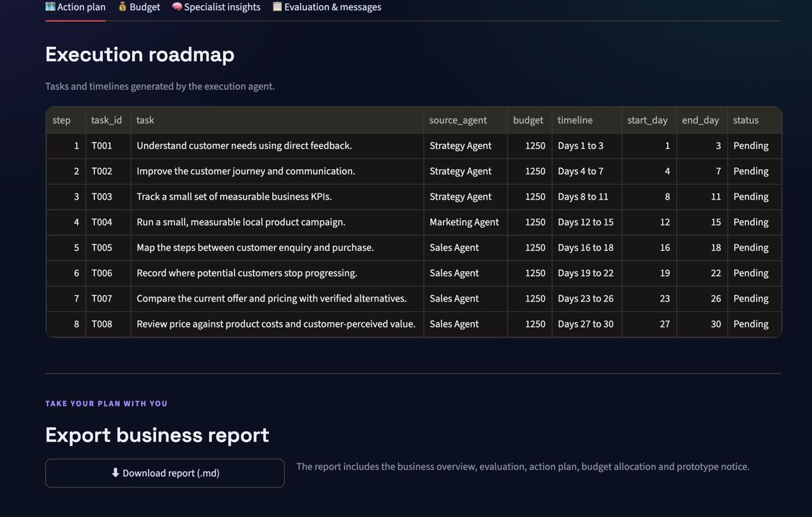
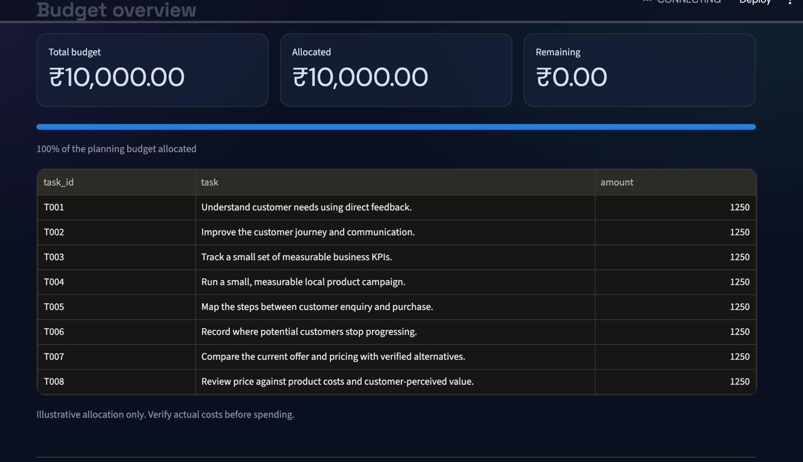
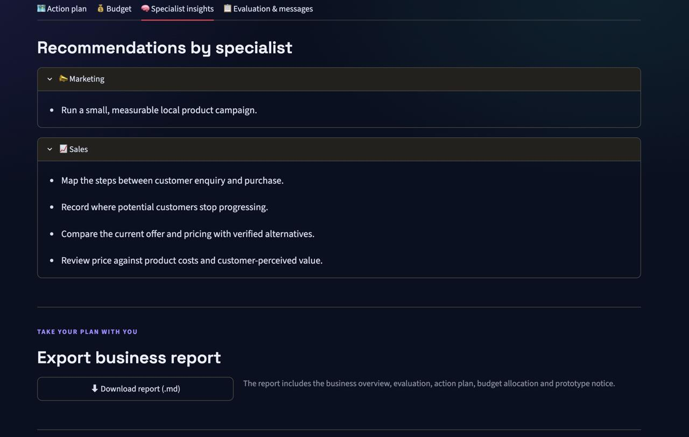
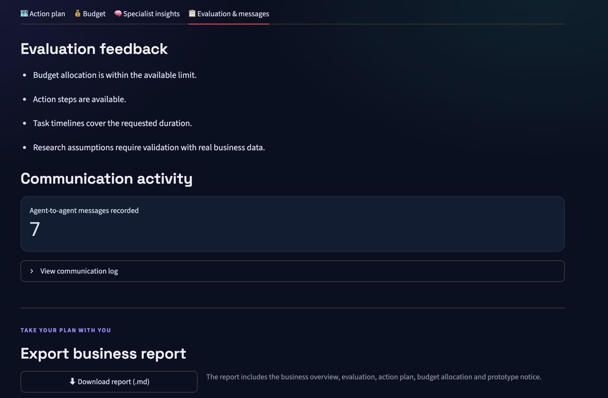
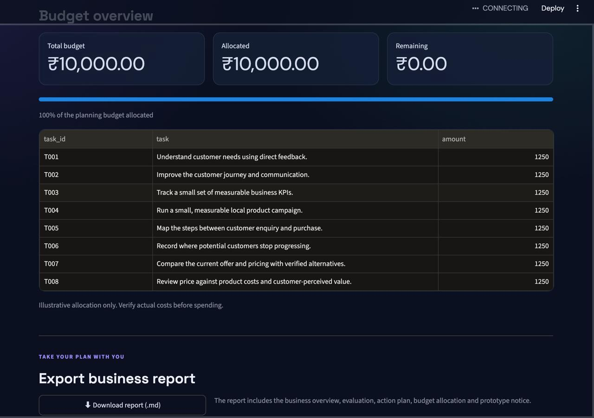

 #  BusinessPilot AI

### One business problem. Multiple expert agents. One actionable plan.

BusinessPilot AI is a multi-agent business-planning prototype designed to help small businesses turn business challenges into structured, actionable plans.

A central Orchestrator coordinates specialist agents to analyze business needs, develop strategies, allocate an illustrative budget, generate execution roadmaps, and evaluate the proposed plan.

---

## Dashboard Preview

### 1. Business Profile & Challenge Input

Describe your business, location, challenge, desired outcome, budget, and planning duration.



### 2. Business Command Centre

View the evaluation score, selected specialists, workflow decision, and agent overview.



### 3. Execution Roadmap

Get structured tasks, assigned specialist agents, budgets, timelines, and task statuses.



### 4. Budget Overview

Review the total planning budget, allocated amount, remaining balance, and task-level allocation.



### 5. Specialist Recommendations

Explore recommendations generated by selected specialist agents.



### 6. Evaluation & Communication

Review evaluation feedback and inspect recorded agent-to-agent communication.



### 7. Business Report Export

Download a Markdown business report containing the business overview, evaluation, action plan, budget allocation, and prototype notice.



---

##  Key Features

- **Business Profiling:** Capture business information and challenges.
- **Research Agent:** Develop research hypotheses using supplied business context.
- **Strategy Agent:** Generate business strategies and identify relevant specialists.
- **Dynamic Specialist Selection:** Select Marketing, Customer Support, Operations, and Sales specialists based on business challenges.
- **Multi-Agent Collaboration:** Maintain shared in-memory state and agent-to-agent communication logs.
- **Finance Agent:** Generate illustrative task-level budget allocations.
- **Execution Agent:** Build structured action plans and execution schedules.
- **Evaluation Agent:** Evaluate proposed plans and provide improvement feedback.
- **Revision Mechanism:** Support up to two improvement attempts.
- **Dashboard:** Visualize business insights, recommendations, execution tasks, and evaluation results.
- **Report Export:** Download the generated business report in Markdown format.

---

##  Multi-Agent Architecture

BusinessPilot AI uses a central Orchestrator to coordinate different specialist agents.

```text
             Business Request
                    |
                    v
               Orchestrator
                    |
          +---------+---------+
          |                   |
          v                   v
     Research Agent      Strategy Agent
                              |
                              v
                    Dynamic Specialist
                         Selection
                              |
                +-------------+-------------+
                |             |             |
                v             v             v
            Marketing     Sales       Operations
                |
                +------ Customer Support
                              |
                              v
                        Finance Agent
                              |
                              v
                       Execution Agent
                              |
                              v
                       Evaluation Agent
                              |
                       Feedback / Revision
                              |
                              v
                     Final Business Plan
```

*Note: Specialist agents are selected dynamically according to the business challenge.*

---

##  Technology Stack

| Technology | Purpose |
|---|---|
| Python | Core application logic |
| Streamlit | Interactive dashboard |
| Object-oriented Python | Agent implementation |
| Git & GitHub | Version control |
| Unittest | Workflow testing |

---

##  Project Structure

```text
BusinessPilot_AI/
│
├── app.py
├── app_backup.py
├── main.py
├── requirements.txt
├── README.md
├── .gitignore
├── .env.example
│
├── screenshots/
│   ├── 01-command-centre.jpg
│   ├── 02-business-profile.jpg
│   ├── 03-budget-overview.jpg
│   ├── 04-budget-and-report-export.jpg
│   ├── 05-evaluation-and-communication.jpg
│   ├── 06-specialist-recommendations.jpg
│   └── 07-execution-roadmap.jpg
│
├── src/
│   └── businesspilot/
│       ├── schemas.py
│       ├── state.py
│       └── agents/
│           ├── agent_selector.py
│           ├── customer_support.py
│           ├── evaluation.py
│           ├── execution.py
│           ├── finance.py
│           ├── marketing.py
│           ├── operations.py
│           ├── orchestrator.py
│           ├── research.py
│           ├── sales.py
│           └── strategy.py
│
└── tests/
    └── test_workflow.py
```

---

##  Installation & Setup

### Requirements

- Python 3.10+
- pip
- Git

### 1. Clone the repository

```bash
git clone https://github.com/mukhiyajat342-netizen/BusinessPilot.AI.git
cd BusinessPilot.AI
```

### 2. Create a virtual environment

```bash
python3 -m venv .venv
```

### 3. Activate the environment

macOS / Linux:

```bash
source .venv/bin/activate
```

Windows:

```bash
.venv\Scripts\activate
```

### 4. Install dependencies

```bash
python -m pip install --upgrade pip
pip install -r requirements.txt
```

---

##  Running the Application

### Launch the Streamlit Dashboard

```bash
streamlit run app.py
```

Open the local URL displayed in your terminal.

Usually:

```text
http://localhost:8501
```

### Run the Terminal Demo

```bash
python main.py
```

---

##  Running Tests

Run the workflow test suite:

```bash
python -m unittest discover -s tests -v
```

---

##  Prototype Limitations

BusinessPilot AI is currently a deterministic, rule-based prototype.

- It does not use an LLM.
- It does not perform verified live market research.
- Research findings are hypotheses based on supplied context.
- It does not connect to real sales or business systems.
- Budget allocations are illustrative equal splits, not vendor quotations or financial advice.
- Human verification is required before implementing recommendations or spending money.

The project demonstrates multi-agent coordination, business-planning workflows, specialist selection, execution planning, and evaluation concepts.

---

##  Future Improvements

- Integrate LLM-powered specialist agents.
- Add verified external market research.
- Introduce persistent business data storage.
- Add real-world financial estimation.
- Improve agent collaboration and communication.
- Add interactive progress tracking.
- Expand automated testing and validation.

---

##  Security

- Never commit `.env` files.
- Never expose API keys, passwords, or private business information.
- Keep `.venv/` out of version control.
- Use `.env.example` as a configuration template.

---

##  Author

**BusinessPilot AI Project**

GitHub Repository:

https://github.com/mukhiyajat342-netizen/BusinessPilot.AI

---

### Built to turn business challenges into actionable plans. 
